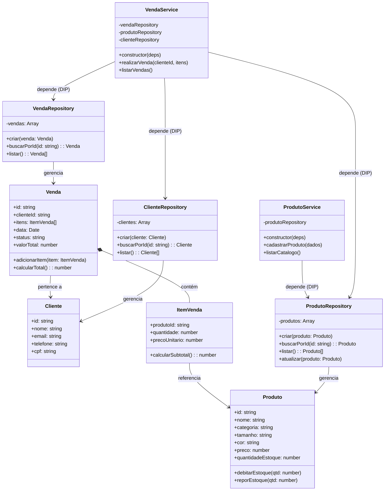

# Modelagem do Projeto 1 — Sistema de Gestão de Loja de Roupas

## 1. Visão Geral do Domínio
Sistema backend para gerenciamento de vendas e controle de estoque de uma loja de roupas. O sistema permite cadastrar peças de vestuário (com variações de tamanho e cor), gerenciar clientes e registrar vendas com baixa automática no estoque e cálculo de totais.

--- 

## 2. Entidades do Domínio (4 Entidades)

1. **`Produto` (Peça de Roupa)**
   * **Atributos:** `id`, `nome`, `categoria` (ex.: camiseta, calça, vestido), `tamanho` (P, M, G, GG), `cor`, `preco`, `quantidadeEstoque`.
   * **Responsabilidade:** Validar valores positivos de preço/estoque e realizar a baixa ou reposição segura de unidades disponíveis.

2. **`Cliente`**
   * **Atributos:** `id`, `nome`, `email`, `telefone`, `cpf`.
   * **Responsabilidade:** Representar os dados cadastrais do comprador e validar informações básicas de contato.

3. **`ItemVenda`**
   * **Atributos:** `produtoId`, `quantidade`, `precoUnitario`.
   * **Responsabilidade:** Representar um item específico dentro de um pedido e calcular seu próprio subtotal (`quantidade * precoUnitario`).

4. **`Venda`**
   * **Atributos:** `id`, `clienteId`, `itens` (lista de `ItemVenda`), `data`, `status` (ex.: `PENDENTE`, `CONCLUIDA`, `CANCELADA`), `valorTotal`.
   * **Responsabilidade:** Agrupar os itens adquiridos por um cliente, calcular o valor total da compra e gerenciar o estado da venda.

---

## 3. Aplicação dos Princípios SOLID (SRP e DIP)

### Single Responsibility Principle (SRP) — *Um motivo para mudar*
Cada camada e classe do sistema possui um único papel bem definido:
* **Entities (`Produto`, `Cliente`, `ItemVenda`, `Venda`):** Concentram apenas os dados e as regras de negócio intrínsecas ao objeto (ex.: calcular subtotal, debitar estoque). Não sabem onde os dados são salvos nem como chegam via HTTP.
* **Repositories (`ProdutoRepository`, `ClienteRepository`, `VendaRepository`):** Responsáveis exclusivamente pela persistência e recuperação dos dados (iniciando com armazenamento em `Array` na S3 e evoluindo para `SQLite` na S5 sem afetar as regras de negócio).
* **Services (`ProdutoService`, `VendaService`):** Orquestram os fluxos de negócio da loja (ex.: verificar se há estoque suficiente de uma camisa tamanho M antes de finalizar a venda).

### Dependency Inversion Principle (DIP) — *Depender de abstrações, não de detalhes*
As classes de serviço **não instanciam** repositórios concretos internamente. Em vez disso, recebem suas dependências via **injeção no construtor**:
* `ProdutoService` recebe `{ produtoRepository }`.
* `VendaService` recebe `{ vendaRepository, produtoRepository, clienteRepository }`.

Isso garante baixo acoplamento e permite testar toda a regra de negócio da loja usando repositórios em memória antes mesmo de configurar o banco de dados.

---

## 4. Diagrama de Classes e Dependências

---

## 5. Fluxo de Camadas (Preparação para S3 / Express)
Seguindo a arquitetura unidirecional definida para o projeto:
`routes` (URLs) $\rightarrow$ `controllers` (HTTP req/res) $\rightarrow$ `services` (Regras da Loja) $\rightarrow$ `repositories / models` (Dados).